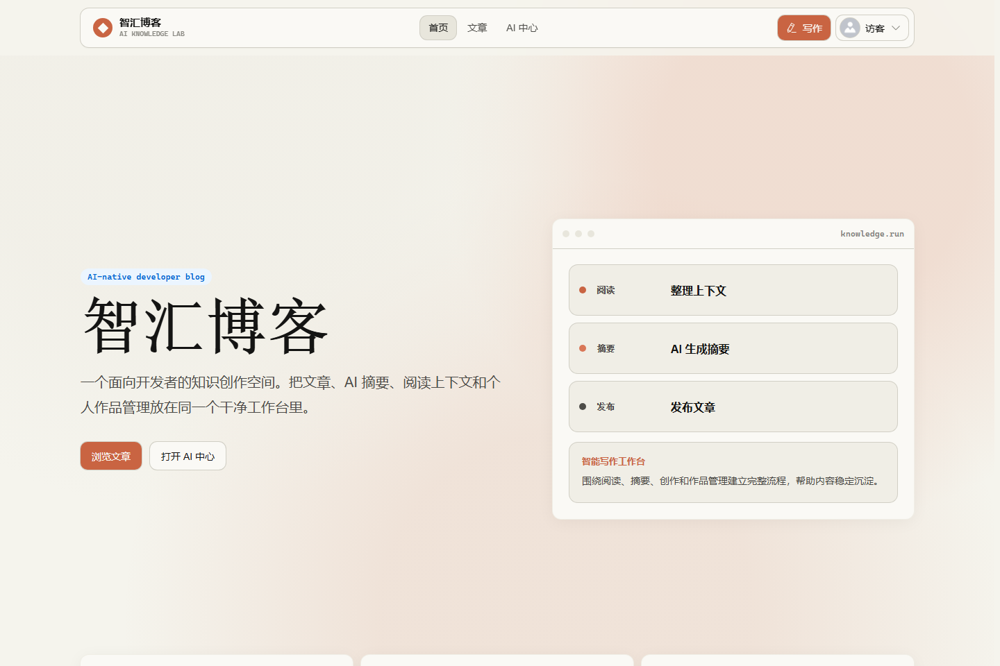
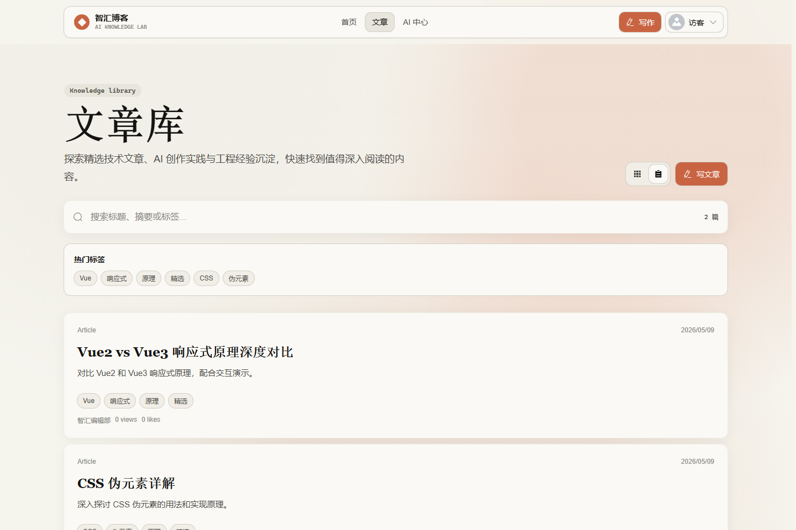
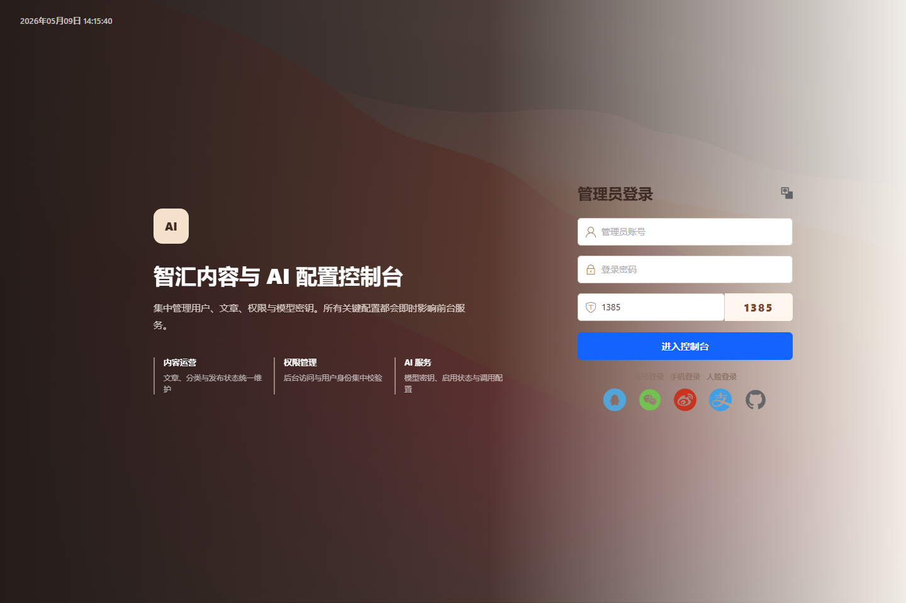

# ThinkLog博客

## 📖 项目简介
一个基于 Vue3 + Flask + MySQL 开发的全栈博客系统。本项目是我独立部署并进行二次开发的全栈实战项目，具备完整的前后端分离架构。

## 🛠️ 技术栈
- **前端**：Vue3 + Vite + TypeScript + Element Plus
- **后端**：Python Flask + SQLAlchemy + JWT
- **数据库**：MySQL 8.0
- **AI能力**：集成大模型API用于辅助写作

## 💻 本地部署指南 & 踩坑记录
*(这部分是面试官最看重的，能证明你具备独立排错能力)*

1. **后端环境**
   - Python 版本必须为 3.11（使用 3.14 会导致 pydantic 依赖解析死锁，无法安装依赖）。
   - 必须提前启动 MySQL 服务。如果没有建库，会报错 `1049 Unknown database`。
   - 修改 `backend` 下的配置，填入正确的数据库账号密码（否则报错 `1045 Access denied`）。

2. **前端环境**
   - 安装 Node.js LTS 版本，并配置 npm 镜像加速。
   - 如果运行 `npm` 报错“禁止运行脚本”，需以管理员身份运行 PowerShell，执行 `Set-ExecutionPolicy RemoteSigned` 解除限制。

3. **代码托管避坑**
   - 提交代码到 GitHub 时，如果代码中包含真实 API Key，会触发 GitHub Push Protection 拦截。
   - 解决方法：将真实 Key 替换为占位符，或者使用 `.env` 文件管理敏感信息，并写入 `.gitignore`。

## 🚀 未来规划
- [ ] 增加文章标签（Tag）系统
- [ ] 引入 Redis 缓存层提升性能
- [ ] 编写 Dockerfile，实现一键部署
## 页面截图

### 前台首页



### 文章库



### 管理后台登录



## 核心功能

### 用户端

- 首页展示与文章列表
- 文章详情、阅读、评论、点赞和收藏
- 用户注册、登录和个人中心
- 文章创建、编辑、发布和删除
- AI 辅助写作与 AI 对话入口

### 管理后台

- 用户管理
- 文章管理
- 角色和权限管理
- AI 模型配置
- 后台运营管理页面

### 后端 API

- JWT 登录鉴权
- 用户、文章、评论、收藏接口
- 图片上传接口
- AI 生成与对话接口
- MySQL 数据持久化

## 技术栈

### 前台 `front/`

- Vue 3
- Vite
- TypeScript
- Pinia
- Vue Router
- Element Plus

### 管理后台 `avue-cli/`

- Vue 3
- Vite
- Avue
- Element Plus
- Axios

### 后端 `backend/`

- Python Flask
- SQLAlchemy
- PyMySQL
- MySQL
- JWT
- Flask-CORS
- OpenAI-compatible API

## 项目结构

```text
AI-Vue3-python-flask-Blog/
├── front/        # 用户端前台
├── avue-cli/     # Avue 管理后台
├── backend/      # Flask 后端 API
└── README.md
```

## 本地启动

### 1. 后端

```bash
cd backend
pip install -r requirements.txt
python init_db.py
python app.py
```

默认后端地址：

```text
http://127.0.0.1:5000
```

### 2. 用户端前台

```bash
cd front
npm install
npm run dev
```

### 3. 管理后台

```bash
cd avue-cli
npm install
npm run dev
```

## 二开方向

你可以基于 `main` 分支继续扩展：

- AI 文章生成、摘要生成、标题推荐
- 后台文章审核和内容运营
- 用户等级、积分、消息通知
- 文章推荐、热门排行、搜索优化
- 数据看板和访问统计
- 文件上传、Markdown 导入、富文本增强
- 部署上线、HTTPS、数据库备份和安全加固

## 分支提示

`main` 是当前稳定的毕设/二开基础版本。

另有开发中的下一代分支 `feat/contextforge-workspace`，正在探索 **知境 ContextForge AI 知识工作台**，包含上下文包、RAG、Embedding 和更清晰的前后台边界。

开发分支说明：[知境 ContextForge 架构、群体与使用说明](https://github.com/linsk27/AI-Vue3-python-flask-Blog/blob/feat/contextforge-workspace/docs/contextforge-architecture-usage.md)
